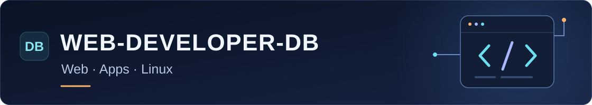
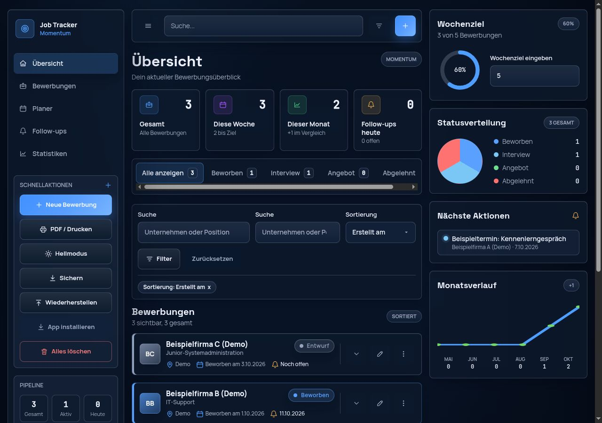
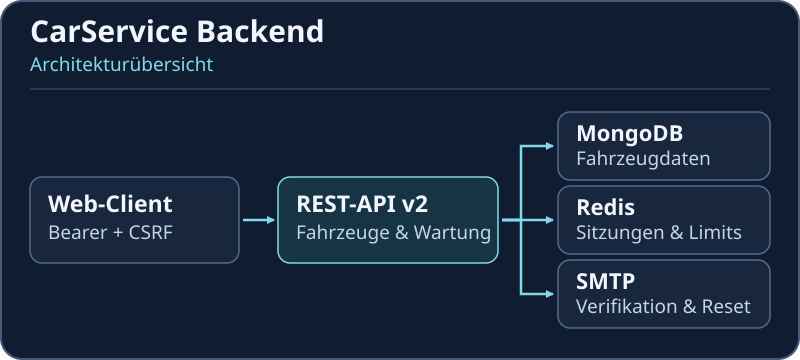

<!--
Pflegehinweise für das GitHub-Profil
Projektbeschreibungen auf den öffentlich dokumentierten Stand beschränken.
Bei neuen Vorschauen ausschließlich Projektbilder und gekennzeichnete Demodaten verwenden.
Benannte Anker bei Umbenennungen erhalten. GitHub rendert sie mit dem Präfix user-content-.
-->

  

# Webentwicklung, Linux & Automatisierung

Ich entwickle Webanwendungen und mobile Apps, passe Linux-Systeme an konkrete Hardware an und automatisiere Abläufe mit Python und KI-Agenten.

Meine praktische Erfahrung mit Computersystemen reicht **über 30 Jahre** zurück, bis zu DOS und frühen Windows-Versionen. Über mehrere Technologiegenerationen hinweg habe ich Rechner aufgebaut, Systeme eingerichtet und technische Fehler systematisch untersucht. Neue Werkzeuge erprobe ich in konkreten Projekten und bewerte sie nach Nutzen, Zuverlässigkeit und Wartungsaufwand.

[Linux & Hardware](#user-content-linux-hardware) · [Web & APIs](#user-content-web-apis) · [KI & Automatisierung](#user-content-ki-automatisierung) · [Arbeitsweise](#user-content-arbeitsweise)

## Ausgewählte Projekte

### Linux & Hardware

#### T95 Home Server · Armbian für eine T95-TV-Box

Für die T95-Referenzplatine habe ich U-Boot und den Linux-Gerätebaum angepasst und den Startvorgang anhand serieller Bootlogs analysiert. Die Hardwaretests bestätigen den Start von microSD sowie den Betrieb von Ethernet, SSH und Samba auf dieser Platine. Der getestete Stand ist als Release-Image verfügbar.

`Armbian` · `U-Boot` · `Device Tree` · `UART` · `Bash` · `Samba`

[Repository](https://github.com/Web-Developer-DB/t95-tvbox-to-armbian-home-server) · [Testmatrix](https://github.com/Web-Developer-DB/t95-tvbox-to-armbian-home-server/blob/main/docs/VALIDATION.md) · [RP2040-UART-Adapter](https://github.com/Web-Developer-DB/rp2040-zero-uart-adapter)

  
   <em>Getestete T95-Referenzplatine</em>

#### Servergy · Flutter-App zur Steuerung von Linux-Servern

Servergy verbindet Wake-on-LAN mit SSH-basierter Verbindungsprüfung und kontrolliertem Herunterfahren. Die App prüft den SSH-Host-Key und verwendet für das Herunterfahren einen Helper mit eng begrenzten Rechten. GitHub Actions führt Formatprüfungen und Flutter-Tests aus. Das Projekt ist in aktiver Entwicklung.

`Flutter` · `Dart` · `Wake-on-LAN` · `SSH` · `systemd`

[Repository & App-Vorschau](https://github.com/Web-Developer-DB/Servergy) · [Architektur](https://github.com/Web-Developer-DB/Servergy/blob/main/docs/architecture.md) · [CI-Konfiguration](https://github.com/Web-Developer-DB/Servergy/blob/main/.github/workflows/quality.yml)

  
   <em>Dashboard und Einstellungen von Servergy</em>

### Web & APIs

#### Job Tracker · Offlinefähige Web-App

Die installierbare Web-App verwaltet Bewerbungen, Termine und Wiedervorlagen offline. Oberfläche, Fachlogik und Datenspeicherung sind getrennt. Die App speichert Daten in IndexedDB und greift bei Bedarf auf `localStorage` zurück. Tests prüfen Statuswechsel, die Wiederherstellung aus versionierten JSON-Backups und den Speicher-Fallback.

`React` · `TypeScript` · `IndexedDB` · `Vitest` · `PWA`

[Repository](https://github.com/Web-Developer-DB/Job-Tracker) · [Live-Demo](https://job-tracker-three-iota.vercel.app/) · [Speicherlogik](https://github.com/Web-Developer-DB/Job-Tracker/blob/main/src/services/storage.ts)

  
   <em>Job-Tracker-Dashboard mit fiktiven Demodaten</em>

#### CarService Backend · REST-API für Fahrzeuge und Wartung

Die REST-API verwaltet Fahrzeuge und Wartungsereignisse. Sie prüft Zugriffsrechte auf Ressourcenebene, verwendet rotierende Refresh-Tokens und begrenzt Anfragen mit Redis. Integrationstests prüfen unter anderem die Trennung von Nutzerdaten und die Sitzungsverwaltung.

`Node.js` · `Express` · `MongoDB` · `Redis` · `REST`

[Repository & API-Dokumentation](https://github.com/Web-Developer-DB/CarService-Backend) · [Betriebshandbuch](https://github.com/Web-Developer-DB/CarService-Backend/blob/main/docs/OPERATIONS.md)

  
   <em>Architektur der CarService REST-API v2</em>

### KI & Automatisierung

#### ApplyFoundry · Agentengestützte Dokumentenerstellung mit Freigabeprüfung

ApplyFoundry verbindet die Dokumentenerstellung aus belegten Angaben mit automatisierten Prüfungen in Python. Coding-Agenten erstellen die Entwürfe. Der Workflow prüft je nach Auftrag Inhalt, Seitenlayout und Auslesbarkeit des PDF-Texts. Die Prüfnachweise sind an die geprüften Dateiversionen gebunden. Die lokale Freigabe setzt eine persönliche Sichtprüfung voraus.

`Python` · `AGENTS.md` · `Chromium` · `PDF` · `GitHub Actions`

[Repository](https://github.com/Web-Developer-DB/apply-foundry) · [Architektur & Tests](https://github.com/Web-Developer-DB/apply-foundry/blob/main/docs/architecture.md) · [Testlauf mit synthetischen Daten](https://github.com/Web-Developer-DB/apply-foundry/blob/main/Tests/Fixtures/Readme/README.md)

  
   <em>Sichtprüfung mit PDF-Vorschauen aus einem synthetischen Testlauf</em>

## Arbeitsweise

- **Fehleranalyse.** Ich grenze Ursachen mit Logs, Messwerten und gezielten Tests ein. Die T95-Testmatrix hält sowohl bestätigte Ergebnisse als auch offene Prüfungen fest.
- **Qualitätssicherung.** Ich trenne Fachlogik so von der Oberfläche, dass sie eigenständig testbar bleibt. Für wiederholbare Prüfungen nutze ich GitHub Actions. Bei agentengestützten Abläufen lege ich fest, welche Ergebnisse automatisch geprüft und welche persönlich freigegeben werden.
- **Technische Dokumentation.** Ich dokumentiere technische Entscheidungen, Einrichtung und Betrieb. Bei Servergy umfasst das die erforderlichen Serverrechte und die Voraussetzungen für Wake-on-LAN.

## Weitere Projekte

- [E-Bike Akku-Rechner](https://github.com/Web-Developer-DB/E-Bike-Akku-Rechner) · Mobile PWA mit getesteter Berechnungslogik, Offline-Nutzung und automatischer Sprachwahl.
- [Logorama](https://github.com/Web-Developer-DB/Logorama) · Offline-Journal mit Suche, JSON-Backups und Tests für Komponenten und Seiten.
- [CarsServiceLog](https://github.com/Web-Developer-DB/CarsServiceLog) · Lokale Fahrzeugakte mit Serviceintervallen, Kostenübersicht und Backup.

[Alle Repositories](https://github.com/Web-Developer-DB?tab=repositories) · [LinkedIn](https://www.linkedin.com/in/web-developer-db)
